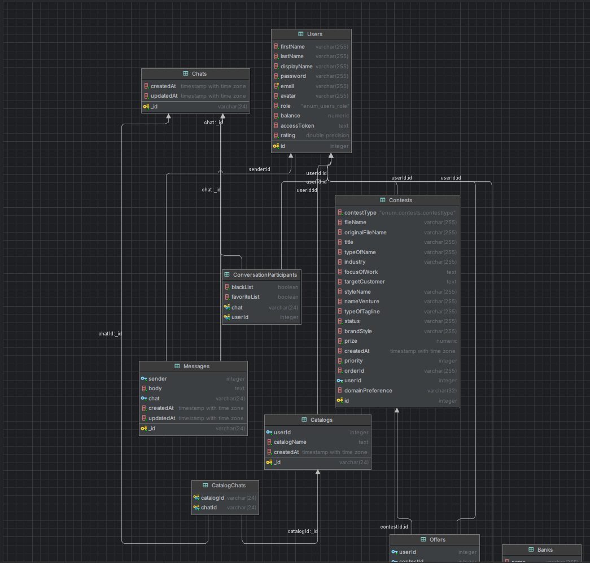

# Squadhelp Exam Project

Full-stack examination project based on the Squadhelp application.

The project includes frontend refactoring, bug fixes, event timers, SQL tasks, error logging, offer moderation, email notifications, and complete chat migration from MongoDB to PostgreSQL.

## Technology stack

### Client

- React 18
- Redux Toolkit
- React Router
- Formik and Yup
- Axios
- Socket.IO Client
- Vite
- Sass

### Server

- Node.js
- Express
- Sequelize
- PostgreSQL
- Socket.IO
- JWT
- Nodemailer
- Multer
- ESLint

### Infrastructure

- Docker
- Docker Compose
- PostgreSQL 15
- MongoDB 6

MongoDB is retained only for reproducing the NoSQL aggregation task. The application chat now works entirely with PostgreSQL.

## Requirements

- Docker 23.0.1 or newer
- Docker Compose
- Git Bash, WSL, Linux, or macOS for running `start-dev.sh`

## Environment configuration

Create `server/.env` from the provided example:

```bash
cp server/.env.example server/.env
```

Configure the following variables:

```env
PORT=3000

JWT_SECRET=replace-with-a-random-secret

SMTP_HOST=smtp.gmail.com
SMTP_PORT=465
SMTP_SECURE=true
SMTP_USER=your-email@gmail.com
SMTP_PASSWORD=your-google-app-password
SMTP_FROM="Squadhelp <your-email@gmail.com>"

# Required only while creating a moderator.
MODERATOR_EMAIL=moderator@example.com
MODERATOR_PASSWORD=replace-with-a-strong-password
```

Replace all placeholder values with real local values.

Never commit `server/.env`, passwords, application passwords, or private JWT secrets.

## Running the application

The recommended way to start the development environment is:

```bash
bash start-dev.sh
```

The script:

1. Builds the Docker images.
2. Starts all development containers.
3. Waits for PostgreSQL.
4. Applies Sequelize migrations.
5. Runs available Sequelize seeders.
6. Prints the application addresses.

After startup, the services are available at:

| Service | Address |
|---|---|
| Client | http://localhost:5000 |
| Server API and Socket.IO | http://localhost:3000 |
| PostgreSQL | localhost:12346 |
| MongoDB | localhost:12345 |

## Manual Docker setup

The project can also be started manually:

```bash
docker compose -f docker-compose-dev.yaml up -d --build
```

Apply migrations:

```bash
docker compose -f docker-compose-dev.yaml exec -T server-dev \
  npx sequelize-cli db:migrate
```

Check migration status:

```bash
docker compose -f docker-compose-dev.yaml exec -T server-dev \
  npx sequelize-cli db:migrate:status
```

Run seeders:

```bash
docker compose -f docker-compose-dev.yaml exec -T server-dev \
  npx sequelize-cli db:seed:all
```

Stop the application:

```bash
docker compose -f docker-compose-dev.yaml down
```

## Creating a moderator

A Moderator cannot be created through public registration. Public registration accepts only the `customer` and `creator` roles.

Add moderator credentials to `server/.env`:

```env
MODERATOR_EMAIL=moderator@example.com
MODERATOR_PASSWORD=your-strong-password
```

Run:

```bash
docker compose -f docker-compose-dev.yaml exec -T server-dev \
  npm run create:moderator
```

Expected output:

```text
Moderator created with ID <id>
```

The script:

- creates a user with the `moderator` role;
- hashes the password before saving it;
- does not promote an existing Customer or Creative account;
- does not create duplicate moderators with the same email.

After creating the account, remove `MODERATOR_EMAIL` and `MODERATOR_PASSWORD` from `server/.env`.

The Moderator signs in through the regular login form and is redirected to:

```text
/moderator/offers
```

## Offer moderation

The project contains a dedicated moderator-only offers page.

A Moderator can:

- view offers without accessing Creative profile information;
- filter offers by moderation status;
- use pagination;
- approve a pending offer;
- reject a pending offer;
- log out from the moderator page.

Access rules are checked on both the client and server:

- only a Moderator can approve or reject an offer;
- a Moderator cannot access regular application functionality;
- a Customer sees only offers approved by a Moderator;
- pending and moderator-rejected offers are not included in the Customer’s offer count;
- a Creative sees only their own offers and their moderation statuses;
- a new offer has the `pending` moderation status by default;
- an already processed offer cannot be moderated again.

## Email notifications

When a Moderator approves or rejects an offer, the Creative receives an email containing the moderation decision.

The server uses Nodemailer and SMTP.

### Gmail configuration

1. Use a dedicated Gmail account for the project.
2. Enable two-step verification for the account.
3. Open [Google App Passwords](https://myaccount.google.com/apppasswords).
4. Create an App Password for the project.
5. Set the generated password as `SMTP_PASSWORD`.
6. Do not use the regular Google account password.

Example configuration:

```env
SMTP_HOST=smtp.gmail.com
SMTP_PORT=465
SMTP_SECURE=true
SMTP_USER=your-email@gmail.com
SMTP_PASSWORD=your-google-app-password
SMTP_FROM="Squadhelp <your-email@gmail.com>"
```

The email is sent from `SMTP_USER` to the email stored in the Creative’s user account.

### Testing the SMTP connection

```bash
docker compose -f docker-compose-dev.yaml exec -T server-dev node -e \
"require('dotenv').config(); const { verifyEmailConnection } = require('./src/services/emailService'); verifyEmailConnection().then(() => { console.log('SMTP connection OK'); process.exit(0); }).catch(error => { console.error(error); process.exit(1); });"
```

Expected output:

```text
SMTP connection OK
```

If `SELF_SIGNED_CERT_IN_CHAIN` appears, antivirus software or a proxy may be intercepting the SMTP TLS connection. TLS certificate verification must not be disabled in the application.

## Implemented examination tasks

### 1. Bug fixes and refactoring

- Legacy class components were converted to functional components.
- Redux `connect` usage was replaced with hooks where applicable.
- Payment and contest attachment handling were fixed.
- Form validation and error handling were improved.
- Unused runtime dependencies were removed.
- Client and server ESLint configurations were updated.
- Accessibility and keyboard interaction problems were fixed in the affected components.
- Source files use consistent LF line endings.

### 2. How It Works page

A responsive How It Works page was implemented and connected to the application navigation.

### 3. Events and timers

The Events page allows a user to:

- create an event with a name, date, time, and notification interval;
- validate event data before submission;
- view events sorted by their start time;
- see a countdown to the actual event time;
- receive a notification before the event;
- see the number of completed events;
- store events separately for each user in `localStorage`.

Timer subscriptions are cleaned up when components are unmounted.

### 4. Button Group

A reusable button group was implemented. Only one option can be active at a time.

### 5. MongoDB aggregation

The MongoDB aggregation counts messages whose `body` contains the word `паровоз`, case-insensitively.

The filtering and counting are performed by MongoDB in one aggregation request.

File:

```text
server/src/dbMongo/task-5.mongodb.js
```

### 6. SQL chat schema

The MongoDB chat structure was redesigned for PostgreSQL.

SQL schema:

```text
server/dbSQL/task-6-chat-schema.sql
```

ERD:

```text
server/dbSQL/chat-erd.png
```



The SQL structure contains:

- `Chats`
- `Messages`
- `ConversationParticipants`
- `Catalogs`
- `CatalogChats`
- relations to `Users`

The schema keeps chat field names close to the original MongoDB structure where practical.

### 7. SQL queries

The following SQL tasks are included:

| Task | File |
|---|---|
| Number of users grouped by role | `server/dbSQL/task-7-users-by-role.sql` |
| Holiday cashback for Customers | `server/dbSQL/task-8-holiday-cashback.sql` |
| Bonus for the three highest-rated Creatives | `server/dbSQL/task-9-top-creators-bonus.sql` |

### 8. Error logger and daily archive

The server error logger writes records using the following structure:

```json
{
  "message": "Some error",
  "time": 1587410256097,
  "code": 500,
  "stackTrace": {
    "name": "Error",
    "stack": "..."
  }
}
```

Implementation:

```text
server/src/utils/errorLogger.js
```

The daily archive scheduler:

- reads the active error log;
- removes `stackTrace` from archived records;
- writes the transformed records to a dated archive file;
- safely clears the active log;
- allows the application to continue writing new errors.

Implementation:

```text
server/src/utils/logArchiveScheduler.js
```

The scheduler is started by the server entry point.

### 9. Offer moderation

The project includes:

- the `moderator` user role;
- moderator-only server middleware;
- a protected moderator page;
- pending, approved, and rejected moderation statuses;
- pagination and status filtering;
- Customer offer visibility filtering;
- Creative offer status visibility;
- Socket.IO notifications;
- email notifications through SMTP.

### 10. Chat migration from MongoDB to PostgreSQL

Runtime chat functionality was migrated from Mongoose to Sequelize and PostgreSQL.

Implemented Sequelize models:

```text
server/src/models/Chat.js
server/src/models/Message.js
server/src/models/ConversationParticipant.js
server/src/models/Catalog.js
server/src/models/CatalogChat.js
```

Migration:

```text
server/src/migrations/q20261029130000-create-chat-schema.js
```

Chat and catalog logic was separated into services and utility functions.

The PostgreSQL implementation supports:

- creating chats;
- sending and loading messages;
- chat previews;
- favorite chats;
- blocked chats;
- creating catalogs;
- renaming catalogs;
- adding chats to catalogs;
- removing chats from catalogs;
- deleting catalogs;
- real-time Socket.IO updates.

Mongoose models and the runtime MongoDB connection were removed after the migration.

## Code quality checks

### Client lint

```bash
docker compose -f docker-compose-dev.yaml exec -T front-react \
  npm run lint
```

### Client production build

```bash
docker compose -f docker-compose-dev.yaml exec -T front-react \
  npm run build
```

### Server lint

```bash
docker compose -f docker-compose-dev.yaml exec -T server-dev \
  npm run lint
```

### Server logs

```bash
docker compose -f docker-compose-dev.yaml logs --tail=100 server-dev
```

## Important project files

```text
.
├── client/
├── server/
│   ├── dbSQL/
│   ├── src/
│   │   ├── controllers/
│   │   ├── migrations/
│   │   ├── models/
│   │   ├── services/
│   │   └── utils/
│   └── .env.example
├── docker-compose-dev.yaml
├── start-dev.sh
└── README.md
```

## Security notes

- Real environment files are excluded from Git.
- JWT secrets are loaded from environment variables.
- Moderator registration is not publicly available.
- Moderator permissions are checked by server middleware.
- User roles are loaded from the database during protected requests.
- SMTP credentials are never exposed to the client.
- TLS certificate verification remains enabled.
